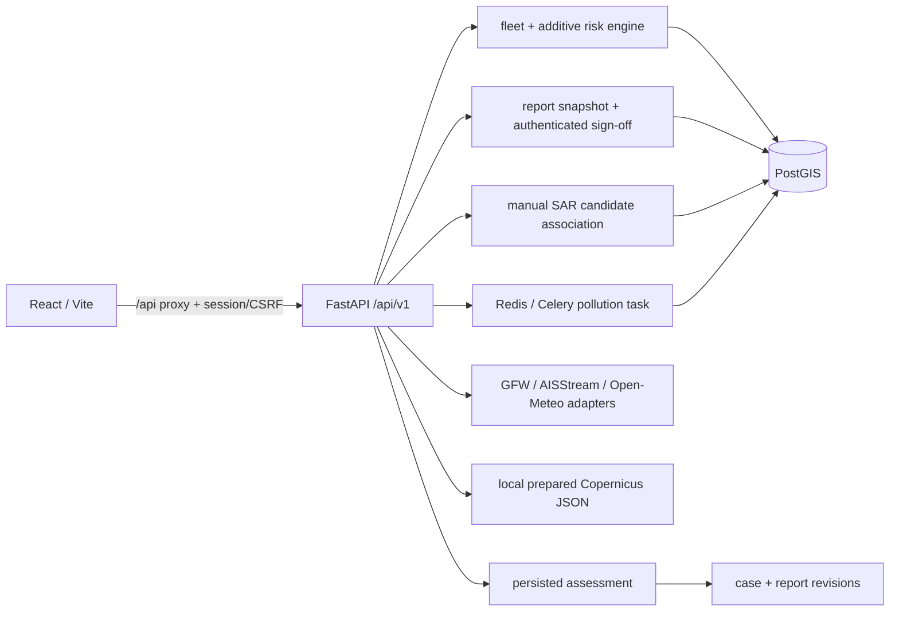

# Architecture as implemented

Reconciled: 7 November 2026. Source and Compose establish structure; runtime state and historical checks are in `PROGRESS.md`. The required future architecture remains in product plan §6.

The diagram shows backend wiring. The browser calls vessels, zones, reports, weather, SAR, historical GFW events/evidence, local auth, persisted assessments and cases. The historical GFW layer remains separate from the local vessel replay/report path; it is not a vessel-track source.

## Modules and boundaries

| Area | Actual responsibility and integration |
|---|---|
| `apps/web/src/App.jsx`, `pages/MapPage.jsx`, `pages/Cases.jsx`, `lib/api.js` | Map, vessel-based alerts/evidence, reports and cases. B's sprint adds source/offline banner, source labels, evidence dates and safer failures. Current integration adds local sign-in/out, CSRF-aware API calls, historical GFW layer/evidence export, assessment/case creation and revision display. Alerts screen still reads vessels API, not legacy alerts API. Spills/settings routes are `NotBuiltYet`; frontend test runner is unavailable in the container. |
| `app/main.py`, `config.py`, `database.py` | FastAPI router registration, Pydantic configuration and SQLAlchemy sessions. `/health` is a static response, not dependency readiness. A-001 registers login/logout/me and reusable session/RBAC dependencies; reports and ingest/SAR/chat mutations apply them. Most read routes remain unprotected. |
| `api/auth.py`, `services/auth.py`, `models/user.py`, migration `006` | Local Argon2id password hashes, opaque HttpOnly session cookie with stored token digest, double-submit CSRF, local throttle and role dependencies. Analyst and Approver are separate; Administrator implies all. Tested against a disposable database; shared development database was observed at 012 (head) on 7 November. Administrator `adishnair` exists and completed browser sign-in. |
| `services/fleet.py`, `risk_engine.py`, `api/vessels.py` | Load tracks/zones, explain behavioural factors/encounters, return list/detail, optionally persist scores onto latest track. Vessel detail adds explicit source/coverage, boundaries and rule limitations, captured in new report snapshots. Risk core uses naive UTC; API/data adapters must preserve correct boundaries. Stored alert entities exist separately; the frontend has not migrated to them. |
| `api/alerts.py`, `services/alert_generator.py`, `route_predictor.py` | Separate legacy prediction/MPA path; deterministic UUIDv5 IDs, deduplication and stored observation timestamps on GET. Stored lifecycle/events live in `api/alert_records.py` (migration 011). Diverges from fleet assessment. Must converge without silently breaking callers. |
| `api/ingest.py`, `scripts/ingest_ais.py`, `demo_data.py`, `scripts/seed_demo.py` | AIS import/rescore and synthetic demo setup. Ingest POSTs now require Analyst/Administrator + CSRF. No complete source-aware dedup/checkpoint boundary. Seed can replace demo MMSI records/update sample zones; not a safe general migration command. |
| `api/sar.py`, migration `004`, index `005` | External point detection storage; nearest AIS candidate within 2 km/15 minutes. Not a detector, real provider adapter or evaluated multi-candidate system. |
| `api/reports.py`, `api/assessments.py`, `api/cases.py`, migrations `003`, `007`, `008` | Database report snapshots, canonical SHA-256, persisted versioned assessments, cases and report revision links. List requires Viewer, draft requires Analyst and sign-off requires Approver; mutations require CSRF and `signed_by` comes from the authenticated session. Local browser flow created a case/revision. Track/assessment provenance and case close/reopen audit events exist (migration 012). Browser status actions, transactional initial creation, full real-source linkage and PDF/outbox remain incomplete. |
| `api/gfw.py` | Identity search, fixed regional apparent-fishing query, selected-event JSON export, quota status. Bounded cache/retry plus best-effort shared Redis pacing. `sources.py`/`source_runs.py` persist bounded provider-run metadata (009); this is not durable storage of GFW event payloads. |
| `api/ocean.py`, `api/environment.py`, `scripts/{fetch,prepare}_copernicus_sst.py` | Open-Meteo recent modelled SST cache and separate historical satellite JSON reader. `/environment/regional` returns one validated historical grid-cell reading in B's expected shape; B's historical SST display is present in the current checkout; the full browser journey remains unverified. Isolated toolbox subset download/preparation. Missing/invalid local artifact → 503. No forecast/ranker. |
| `api/aisstream.py` | Bounded geographic WebSocket snapshot, normalization and short cache. No worker/reconnect/checkpoint/persistence; earlier live windows had zero positions. |
| `api/weather.py` | Event/gap modelled wind and wave context; missing/failed source is represented with known event coordinates/time. Reports can opt in to a fresh event-time snapshot before hashing; model-valid times are distinct from gap time and it may differ from prior display. No evaluated triage recommendation or automatic score reduction. |
| `api/chat.py`, `services/chatbot.py`, `agent_lightning.py` | Network Gemini assistant and bounded tool calls using configured app model. Chat POSTs now require Analyst/Administrator + CSRF. Legacy Lightning module presence is not evidence of trained RL feedback. Not an offline report model. |
| `api/analytics.py`, `api/map.py`, `models/**`, `schemas/**` | Existing statistics/health/map views and database/payload models. Do not infer evaluated climate metrics from endpoint names. |
| `tasks/celery_app.py`, `pollution_detector.py`, `model_registry.py` | Satellite pollution job/model infrastructure. Missing weights prevent meaningful inference. Worker still has fallback geometry when georeferencing is missing: release blocker before exposing this pipeline. Prefetch=1 is not a global single-heavy-job guarantee. |

## Storage and runtime

`infra/docker-compose.yml` starts backend (migrations then Uvicorn reload), frontend, Celery worker, Redis and PostGIS. It binds the API source directory into API/worker, mounts a separate `model_weights` volume over `/app/models`, and persists PostGIS in `postgres_data`. The model volume can hide host model files; existence on host is not proof the worker can load them. No scheduler/beat service or production/offline profile exists.

Alembic files run from `001_initial_schema.py` through `012_case_events.py`. Existing entities include vessel tracks, protected areas, pollution/health records, incident reports, SAR detections, users/sessions, vessel assessments and investigation cases/revisions. Provider runs, track provenance, alert records/events and case events are present in migrations 009?012. Future jobs must use additive migrations owned by A. Check the actual head before assigning a new migration number.

Compose loads `apps/api/.env` for API/worker; explicit `environment` values override it, including database/Redis. The local Copernicus NetCDF/JSON are bind-mounted but ignored by Git. Fresh checkout needs acquisition/preparation. GFW/AIS/ocean in-memory caches vanish on restart. `.codegraph/` is local code-intelligence state, not application persistence.

## Intended integration still pending

Validated source records → normalized observations with provenance/mode → versioned assessment → stable alert/events → case → immutable report revision → authenticated approval → verified export/explicit delivery. Parts are implemented as described above; the complete real-source chain is not yet integrated. Source selection, time availability and absence of data must remain explicit throughout.

Validated trained weights, SAR accuracy, hotspot backtest, GNOME forcing/scenario, licensed offline maps, backup/restore evidence and complete auth are absent/unverified. Keep optional hosted Supabase separate from the required local/offline auth decision. Shared endpoint handoff: `docs/contracts/USER_A_DATA_API.md`; frozen OpenAPI/examples for the full future workflow are still missing.
