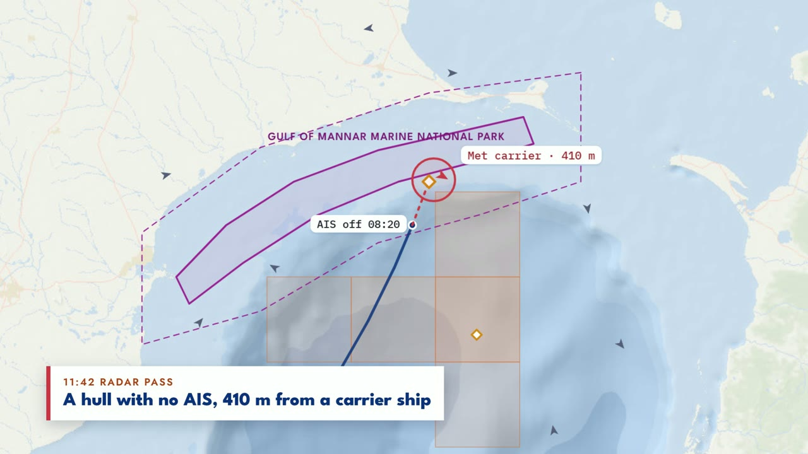
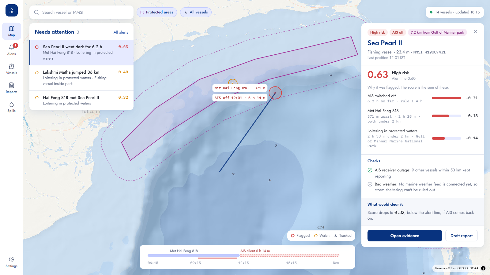

# SamudraSense

**Climate-aware AI for ocean protection.** *Samudra* is Sanskrit for ocean.

SamudraSense is a prototype regional marine investigation workstation: inspect vessel activity, explain risk signals and export sourced evidence. Ocean activity ranking and complete offline operation remain release targets; session-derived report sign-off exists, while the full source-bound case journey is incomplete.

Built by **Team Code4Seas** (Adish Nair, Aditya Patil, Aditya Saraf) for **Indradhanu IGC 2026**, track *AI for Climate Change: Ocean & Marine Protection*. It grows out of our earlier platform, BlueGuard.

> **Prototype status (Nov 2026):** the map, explainable AIS risk engine, basic evidence screens, report snapshots and local authentication foundation are implemented. Report API sign-off uses a logged-in Approver; other API routes remain unprotected and the frontend includes local sign-in. Open-Meteo weather context is available for AIS gaps. External georeferenced SAR detections can be entered and compared with nearby AIS, but no trained SAR detector is integrated or validated yet. Weather does not automatically change alert scores. Hotspot forecasts, dispatch and the spill simulator remain planned. See [the low-cost data research](docs/LOW_COST_DATA.md).

## Delivery plan

### Shared AI harness

Start development sessions with [AGENTS.md](AGENTS.md), [PROGRESS.md](PROGRESS.md) and [tasks/current.md](tasks/current.md). Codex selects and briefs one bounded task; OpenCode implements it using the user's selected model; Codex inspects the changes and acceptance evidence before updating state and assigning the next task. [The handoff protocol](docs/AGENT_HARNESS.md) contains the supported PowerShell CLI command, lifecycle, interruption handling and completion report.

[PLAN.md](PLAN.md) maps the retained roadmap to executable chunks; [ARCHITECTURE.md](ARCHITECTURE.md) describes actual wiring; [DECISIONS.md](DECISIONS.md) preserves settled choices. The existing [data manifest](docs/DATA_MANIFEST.md) is the sole dataset register. Four shared skills live in `.agents/skills/`; both agents load only those relevant to the task. No additional orchestration service is needed. OpenCode uses DeepSeek V4.1 Flash; A-001 is complete. See [PROGRESS.md](PROGRESS.md) for current integration gaps and the [judge review](docs/HACKATHON_JUDGE_REVIEW.md) for demo readiness.

See the [final product delivery plan](docs/FINAL_PRODUCT_PLAN.md) for feature specifications, data sources, two-person ownership, dated phases and acceptance checks. The [research appendix](docs/PLAN_RESEARCH.md) records competitive findings and provider constraints checked on 2 November 2026.

Current execution state is tracked in [PROGRESS.md](PROGRESS.md); [User A progress](docs/USER_A_PROGRESS.md) retains implementation evidence, and the [data manifest](docs/DATA_MANIFEST.md) tracks access. `GET /api/v1/ocean/temperature` returns recent modelled sea-surface temperature and provenance for a requested location (default Gulf of Mannar); it is not an in-situ observation or fishing prediction.

`GET /api/v1/ocean/observations` serves a locally prepared historical Copernicus satellite SST subset with observation dates and provenance. The local dataset is excluded from Git; preparation details are in the data manifest.

When creating a report, an authenticated Analyst can request `include_regional_ocean_context: true`. Historical observations are included in the hashed snapshot as regional context; they are not asserted to coincide with a vessel event. An authenticated Approver signs off; case/report revision links and case status audit events exist; complete source linkage and browser lifecycle actions remain pending. See the [auth contract](docs/contracts/AUTH_API.md).

`GET /api/v1/aisstream/snapshot` requests a short live AISStream sample for the Gulf of Mannar using the server-side key. It does not persist or merge results with the synthetic fleet, and an empty sample does not establish the area's coverage. Most read routes remain public; keep the prototype API local.

`GET /api/v1/gfw/vessels/search?query=7831410` searches Global Fishing Watch's public vessel identity dataset with a server-side token. `/api/v1/gfw/status` shows the last rate-limit headers observed by that backend process and the pacing transport (`redis` shared or process-local fallback); see the data manifest for cache and quota limitations. Identity results are not live positions.

`GET /api/v1/gfw/events/regional?start_date=2024-01-01&end_date=2025-01-01` lists inferred apparent-fishing events in the initial Gulf of Mannar box; the end date is exclusive. Use an event ID and the same date range, offset and limit with `/api/v1/gfw/events/evidence` to download a checksummed JSON snapshot. Set `include_regional_ocean_context=true` to add the prepared historical SST subset. Context and event dates are independent; the export does not imply a causal relationship or establish an offence. The checksum is not a digital signature and the export is not an authenticated approval.

The same event page is available as map-ready GeoJSON at `/api/v1/gfw/events/regional/geojson` with the same date and pagination parameters. The map includes an opt-in historical events layer and evidence download. These are historical inferred event locations, not live ship positions or tracks; browser verification remains pending.

`GET /api/v1/sources/health` is a read-only snapshot of local replay freshness, the prepared historical SST subset, GFW/AISStream/Open-Meteo configuration and the last persisted bounded provider run. It makes no provider request and never returns credentials; `configured`, `not_checked` or a last-run status must not be read as live availability. See the [source health contract](docs/contracts/SOURCE_HEALTH_API.md). `POST /api/v1/sources/runs` is a separate Analyst/Admin route (CSRF required) that runs exactly one bounded AISStream snapshot or historical GFW regional-event page. AIS runs default to metadata-only checkpoints; storing normalized live positions additionally requires `persist_positions: true` and the account-holder-approved local opt-in `AISSTREAM_PERSIST_ENABLED=true`.

Vessel positions now carry truthful provenance. `/vessels/`, `/vessels/{mmsi}` and the vessel map layer expose `source` and `source_mode` (`live`, `historical`, `replay`, `synthetic`, `unknown`); missing provenance stays `unknown`. Demo seeding writes `synthetic`; `POST /ingest/ais` records only caller-declared `source`/`source_mode` and defaults to `caller-supplied AIS ingest`/`unknown`. Assessed `source_mode` is derived from the evaluated positions, with `mixed` when they disagree. None of this proves receiver coverage or that any row is a real provider track.

## Demo video

[](https://cdn.jsdelivr.net/gh/Aditya-Patil27/marine_gurad@ap/docs/demo/samudrasense-walkthrough.mp4)

**[▶ Watch the 96-second walkthrough](https://cdn.jsdelivr.net/gh/Aditya-Patil27/marine_gurad@ap/docs/demo/samudrasense-walkthrough.mp4)** (opens in the browser; [download from the repo](docs/demo/samudrasense-walkthrough.mp4))

The video follows one case through the whole console: Sea Pearl II goes dark in the Gulf of Mannar park buffer and a radar pass finds its hull next to a carrier. Alerts are sorted with weather-explained ones kept aside, the evidence page shows how each step added to the score, the incident report links every figure to its source before an officer signs, and the spill simulator shows where oil would drift. It walks through the signed-off screen designs with sample data.

### Built so far

The video above is a sample-data design walkthrough, not proof of working SAR, forecasts, authenticated approval, dispatch or spills. The screenshot below illustrates the existing map prototype. See PROGRESS.md for actual integration status.



---

## The problem

Oceans absorb about 90% of the extra heat from global warming (IPCC AR6). As seas warm, fish stocks move into new waters, and illegal fleets follow them. Up to 26 Mt of fish a year may be caught illegally, worth up to US$23 billion (FAO, upper estimate), and about 75% of industrial fishing vessels are not publicly tracked (*Nature*, 2024).

Today's monitoring tools have four gaps:

- **Alert fatigue.** Storms make ships slow down and loiter, which sets off false alarms.
- **Wasted compute.** AI scans every satellite tile instead of the ones that matter.
- **No follow-up.** Detections rarely become evidence that an authority can act on.
- **Cloud cost.** Satellite AI is out of reach for NGOs and small coastal agencies.

## The idea

Three verbs: **Predict, Detect, Act.**

These are release intentions, not a list of completed features:

1. **Predict.** Evaluate regional ocean conditions and rank likely fishing activity against transparent baselines. This does not predict illegality. Retain non-hotspot scan coverage to measure blind spots.
2. **Detect.** Associate permitted SAR observations with AIS candidates; unmatched observations remain uncertain investigation signals.
3. **Verify.** Show event-time weather, source coverage and encounters. Weather alone must not close an alert; an analyst can choose Watch with a recorded reason.
4. **Act.** Bind evidence to report revisions and require authenticated review. Templates work without a language model. Delivery needs explicit authorization and remains unimplemented.

| # | Innovation | What it does |
|---|---|---|
| 01 | Ocean/activity ranking | Baselines and evaluation pending; current SST is context only |
| 02 | SAR + AIS association | Manual candidate matcher exists; real point adapter/evaluation pending |
| 03 | Explainable behavior | Additive rules exist; persistent alert/event lifecycle pending |
| 04 | Weather-aware triage | Context exists; recommendations and logged Watch decisions pending |
| 05 | Encounter graph | Basic encounter evidence exists; full source-linked graph pending |
| 06 | Reviewed reports | Snapshot/hash exists; authenticated approval/revisions/delivery pending |
| 07 | Spill scenario | GNOME and real forcing pending; UI placeholder |
| 08 | Economical workstation use | CPU/offline deployment and resource measurements are targets |

### Explainable by design

An unexplained score is insufficient evidence. The required release will show:

- **Why it was flagged.** The risk score is additive: each behaviour adds points, so the breakdown *is* the score.
- **What was ruled out.** For example bad weather or an AIS receiver outage.
- **What would clear it.** For example "drops to 0.45 if AIS resumes within 4 h".
- **Where every figure comes from.** Each number in a report links to its database record, and sign-off is blocked while any number is unlinked. The LLM writes only the sentences.

Only add explanations appropriate to models actually integrated and evaluated. Optional Ai2 SAR inference is separate from pollution YOLO. LSTM infrastructure without validated weights is not a validated route predictor.

### Honest limits

| Question | Our answer |
|---|---|
| Is the current demo real time? | GFW events and satellite SST are historical. AISStream samples live data, but usable positions/coverage remain unverified. |
| Does weather clear an alert? | No. Current weather context does not change the risk score. |
| Are reports authenticated? | No. Typed names and colocated hashes are a prototype; session-based approval is pending. |
| Does a gap or unmatched radar point prove deliberate silence? | No. Missing coverage, time mismatch and association uncertainty remain possible. |
| Do encounters establish transshipment? | No. Proximity is investigation context; full graph/evaluation is pending. |

### How we will measure it

| Open dataset | Used for | Metric |
|---|---|---|
| Optional small xView3-SAR sample | SAR evaluation after access/size/training-overlap checks | Precision/recall on genuinely unseen scenes; no full split download |
| Global Fishing Watch AIS + fishing effort | Hotspot labels, encounters | Share of next month's fishing effort inside our top-ranked cells |
| Copernicus Marine SST + chlorophyll | Hotspot forecasts | Mean absolute error per grid cell |
| Open-Meteo Marine | Alert triage | False alerts removed vs. real alerts wrongly downgraded |
| NOAA GNOME runs | Spill simulator | Overlap between our impact zones and GNOME's |

We start with India's coasts, including the Gulf of Mannar and Gulf of Kutch protected areas. The work supports **SDG 14** (Life Below Water) and **SDG 13** (Climate Action).

---

## Roadmap

| When | Milestone | Scope |
|---|---|---|
| Existing prototype | BlueGuard / SamudraSense code | AIS import/rules, indicative zones, React map/evidence/reports and Gemini chat infrastructure; trained accuracy unverified |
| Sep 2026 | Revival and design | Repo fixed and restructured; SamudraSense screens designed ([docs/design](docs/design/DESIGN.md)) |
| 10 Nov 2026 | Real-data judging slice | Historical vessel event + ocean context + sourced export/video; optional SAR/baseline/GNOME only if verified |
| 20 Nov / 2 Dec 2026 | Full P3 / P4 gates | Investigation, then baselines/spills/offline/delivery |
| 11 Dec 2026 | Tested v1 target | F01–F14 acceptance and reproducible release; not yet complete |
| 8 / 15 Jan 2027 | Pilot / presentation reviews | Measured results and evidence-pack freeze |
| 20–21 Jan 2027 | Grand finale | Demonstrate completed, evidenced features; verify event arrangements independently |

---

## Tech stack

### In the code today

| Layer | Technology |
|---|---|
| Frontend (`apps/web`) | React 18, Vite 7, React Router 7, MapLibre GL JS, Tailwind CSS 3, Lucide, Fontsource (bundled fonts) |
| API (`apps/api`) | Python 3.11, FastAPI, SQLModel, Pydantic 2, Alembic, Uvicorn |
| Data | PostgreSQL 15 + PostGIS 3.3, GeoAlchemy2, Shapely, Fiona, PyProj |
| Jobs | Celery on Redis 7 |
| AI / ML | Explainable rule-based risk engine (`app/services/risk_engine.py`), PyTorch 2.2 (LSTM route model), Ultralytics YOLOv8 (detector, no trained weights yet), Google Gemini via `google-genai` for the chat API |
| Infra | Docker Compose; Supabase Postgres as an optional hosted database |

### Planned for SamudraSense

| Layer | Technology | Replaces |
|---|---|---|
| Maps | Offline PMTiles basemap, deck.gl data layers | Esri online ocean tiles |
| UI | Radix Primitives with our design tokens, Observable Plot / visx, Cytoscape.js for the encounter graph | — |
| Jobs | Keep Redis/Celery; add bounded jobs/checkpoints and one scheduler | No queue rewrite |
| AI / ML | Transparent baselines; optional isolated Ai2 SAR adapter after evaluation | No assumed trained SAR/hotspot model |
| Reports | Templates; optional local wording model after hardware/licence check | Independent Gemini chat need not be replaced |
| Data sources | Copernicus Marine, Global Fishing Watch, Open-Meteo Marine, OSM | — |

**Resource targets are unmeasured:** the plan targets a CPU-capable core on a 16 GB-class workstation with bounded data/heavy jobs. Optional model memory and GPU use require benchmarks. Current providers, chat and online map assets need internet; offline operation is unfinished.

---

## Repository layout

```
marine_gurad/
├── apps/
│   ├── api/          FastAPI backend: routes, models, services, Alembic migrations, scripts
│   └── web/          React + Vite dashboard
├── services/         Historical reserved area; no new service in current scope
├── ml/               Training code, datasets and model cards (planned)
├── infra/            docker-compose.yml and its .env.example
└── docs/
    └── design/       DESIGN.md, HTML screen mockups and rendered screenshots
```

---

## Running it

### With Docker (recommended)

```bash
git clone https://github.com/Aditya-Patil27/marine_gurad.git
cd marine_gurad
cp apps/api/.env.example apps/api/.env   # set GEMINI_API_KEY for the chat assistant
docker compose -f infra/docker-compose.yml up --build
```

- Console: http://127.0.0.1:5173
- API docs: http://127.0.0.1:8000/docs

To see the Gulf of Mannar demo story (a trawler that meets a carrier and switches AIS off), load it once. Use this only in a separate disposable demo environment; it replaces demo records. The shared development data must be preserved. A fixed historical replay selection is pending to prevent the existing observations aging out:

```bash
docker exec -w /app samudrasense_backend python scripts/seed_demo.py
```

Compose starts PostGIS, Redis, the API, a Celery worker and the frontend, and runs the database migrations on start. To use Supabase instead of the local database, set `DATABASE_URL` in `infra/.env`.

For an empty local database, set `SEED_DEMO_IF_EMPTY=true` in `infra/.env` before starting Compose to load the synthetic demonstration once. Existing AIS records cause automatic seeding to be skipped. The manual seed command above **replaces records for the demo MMSIs and updates sample protected-area boundaries**; back up the database first if it contains data you need to keep. Demo vessels and boundaries are fictional/indicative, and timestamps eventually become stale.

Before a judged demonstration, run the read-only readiness check. It verifies the Alembic head, all 14 replay vessels, replay freshness, the local Administrator, the bounded GFW/SST endpoints and case/report preservation, and can confirm sign-in with hidden input. It never reseeds or resets:

```bash
docker exec -it -w /app samudrasense_backend python scripts/verify_judging_replay.py
```

A missing credential or an unavailable external source is reported as `PARTIAL`/`FAIL`, never as a pass. See the [judging replay runbook](docs/demo/JUDGING_REPLAY_RUNBOOK.md) for the exact browser journey, source statements and failure states.

Open **Alerts** to review scored vessels and inspect evidence. The report API now requires local login and CSRF: Analysts draft, Approvers sign, and the stored reviewer comes from the session. No local admin account is created automatically; see [auth setup](docs/AUTH_SETUP.md). The current frontend has not yet integrated login or CSRF, so its report screen cannot complete these actions. Hashes stored beside the data are not digital signatures. Reports are not sent by the app. Most other API routes remain unprotected; do not expose the prototype publicly.

`POST /api/v1/sar/detections` accepts an externally generated georeferenced detection with `observed_at` (timezone required), `latitude`, `longitude`, `source`, `scene_id`, and optional `confidence`. It stores the detection and the closest AIS ping within 2 km and 15 minutes as a **candidate**, not a confirmed identity. An unmatched detection does not prove that AIS was deliberately switched off. This endpoint does not run a SAR model; validate real scenes and detection accuracy before operational use.

If upgrading an older stack, inspect database/user configuration and preserve a backup before applying an explicit migration plan. Do not reset volumes as a routine upgrade or test step.

### Without Docker

You need Python 3.11 (PyTorch 2.2 has no wheels for newer versions), Node.js 20.19+, PostgreSQL 15 with PostGIS, and Redis.

```bash
# API
cd apps/api
python -m venv venv && source venv/bin/activate   # Windows: venv\Scripts\activate
pip install --extra-index-url https://download.pytorch.org/whl/cpu -r requirements.txt
createdb samudrasense_db && psql samudrasense_db -c "CREATE EXTENSION postgis;"
alembic upgrade head
python scripts/load_mpas.py          # optional: sample protected areas
uvicorn app.main:app --reload --port 8000

# Web (second terminal)
cd apps/web
npm ci
npm run dev                          # proxies /api to http://127.0.0.1:8000
```

### Loading data

```bash
cd apps/api
python scripts/seed_demo.py                    # invented Gulf of Mannar story, relative to now
python scripts/ingest_ais.py path/to/AIS.csv   # MarineCadastre-style CSV: MMSI, LAT, LON, BaseDateTime, SOG, COG, ...
python scripts/ingest_sentinel.py              # satellite pollution detections (needs trained weights)
```

Trained model weights are not committed. The API looks for them in `apps/api/models/` (`pollution_yolo.pt`, `route_lstm.pt`). Without them, route prediction falls back to linear extrapolation and satellite detection returns 503.

### Tests

```bash
# API
docker exec -w /app samudrasense_backend sh -c "pip install -r requirements-dev.txt && python -m pytest tests"

# Web (Vitest and Testing Library; needs no API or browser)
cd apps/web
npm ci
npm run build && npm test
```

The web tests cover the console's states and flows in jsdom. The map itself needs WebGL, so what it draws is checked in a browser.

---

## API

All routes are under `/api/v1`. Full reference at `/docs` when the API is running.

| Method | Route | Purpose |
|---|---|---|
| GET | `/vessels/?hours=24` | Every vessel seen in the window with its risk score, state, headline and provenance |
| GET | `/vessels/{mmsi}` | One vessel: track, provenance, score breakdown, checks, what would clear it, gaps, encounters |
| GET | `/map/zones` | Protected areas and the 10 km buffer the risk engine uses |
| GET | `/map/layers?layer_type=vessels\|pollution\|mpas&bbox=minLon,minLat,maxLon,maxLat` | GeoJSON map layers |
| GET | `/alerts/?severity=HIGH&limit=20` | Stable, deduplicated ephemeral alert projection; not persisted lifecycle |
| POST | `/alerts/sync` | Analyst/Admin + CSRF: persist the current deduplicated generator conditions |
| GET | `/alerts/stored?status=open&severity=HIGH` | Viewer+: persisted alerts with status and observation history |
| GET | `/alerts/stored/{id}` | Viewer+: one persisted alert plus its lifecycle event log |
| POST | `/alerts/stored/{id}/acknowledge` | Analyst/Admin + CSRF: `open` → `acknowledged` with expected version |
| POST | `/alerts/stored/{id}/resolve` | Analyst/Admin + CSRF: resolve with optional note and expected version |
| POST | `/alerts/stored/{id}/reopen` | Analyst/Admin + CSRF: `resolved` → `open` with expected version |
| GET | `/analytics/statistics` | Headline counts for the dashboard |
| GET | `/analytics/ohi?days=180` | Ocean Health Index time series |
| GET | `/sources/health` | Read-only local/source configuration and last-run status; no provider call |
| POST | `/sources/runs` | Analyst/Admin + CSRF: one bounded AIS or historical GFW run, metadata only |
| POST | `/ingest/ais` | Ingest AIS positions and rescore the fleet |
| POST | `/ingest/satellite-image` | Run detection on a satellite image URL |
| POST | `/chat/message` | Ask the assistant (Gemini with database tools) |

---

## Security notes

- Never commit `.env` files. Use the `.env.example` files as templates.
- Mutation routes require a session role and CSRF token; many read routes remain public. Don't expose the API publicly until every route's protection is verified.
- Early commits in this repo contained a Gemini API key and a Supabase service-role key. Both must be treated as leaked and rotated.

---

## Data and acknowledgements

Global Fishing Watch, Copernicus / Sentinel, xView3-SAR, MarineCadastre AIS, Protected Planet (WDPA), Open-Meteo, NOAA GNOME and OpenStreetMap.

Protected-area boundaries and sample data in this repo are indicative placeholders. Replace them with official WDPA data before any real use.
